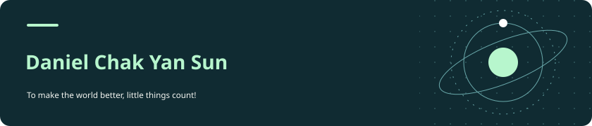

# Hi, I’m Daniel Chak Yan Sun

I am a high school student who just codes for fun :)

## Featured project
What I've learnt(<https://github.com/DanielSun29/data-structures>)
Game I made(<https://microstudio.io/TigerH/adventure_rpg_template/S3HAGBBV/>)

I've learnt data structures in C#; and now I'm developing my own app!

## Tools I’ve used
- Markdown: I organized a README with headings and links.
- C# Experience in backend datastructures
- Game development using microstudio

## What I’m learning next
I'm currently developing my own app for health & well-being among elders

## My toolbox

Data Structures
 

- 🔭 I’m currently working on my own app
- 🌱 I’m currently learning app development ig
- 📫 How to reach me: email
- 😄 Pronouns: He/Him

<!--
**DanielSun29/DanielSun29** is a ✨ _special_ ✨ repository because its `README.md` (this file) appears on your GitHub profile.

Here are some ideas to get you started:

- 🔭 I’m currently working on ...
- 🌱 I’m currently learning ...
- 👯 I’m looking to collaborate on ...
- 🤔 I’m looking for help with ...
- 💬 Ask me about ...
- 📫 How to reach me: ...
- 😄 Pronouns: ...
- ⚡ Fun fact: ...
-->
